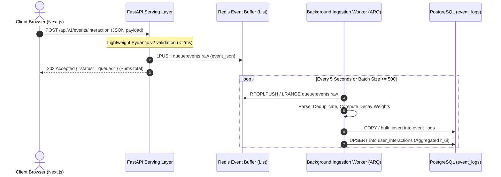
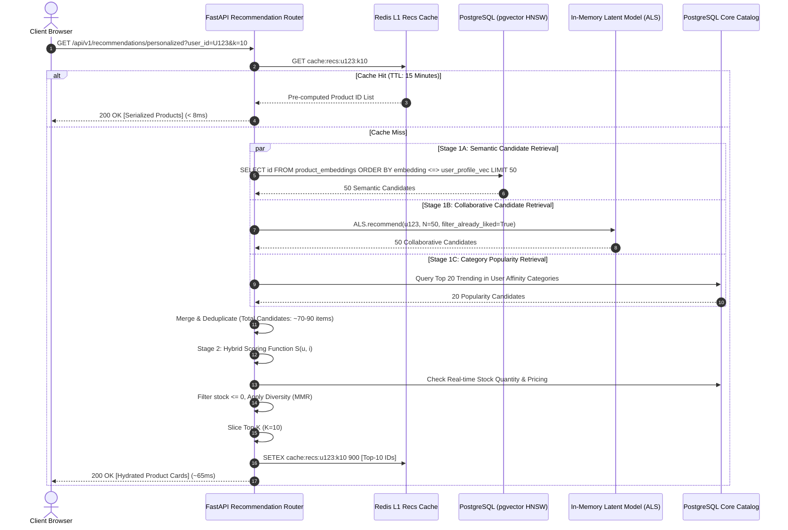
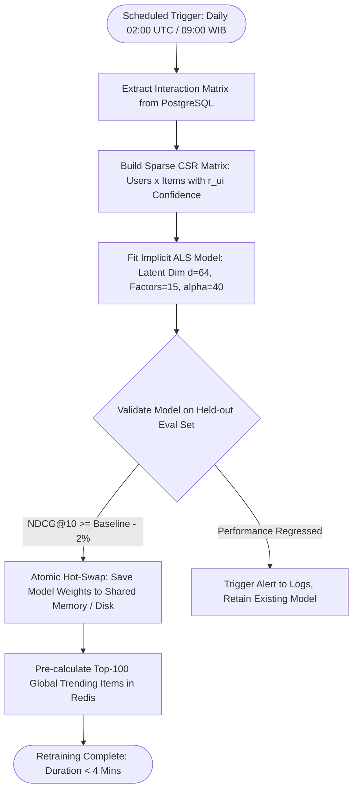

# 02. System Architecture Specification
**Project:** Sistem Informasi E-Commerce UMKM Berbasis Personalized Hybrid Recommendation System  
**Document ID:** SPEC-DOC-002  
**Target Audience:** Autonomous AI Coding Agents, Systems Architects, DevOps Engineers  
**Status:** Approved for Implementation  

---

## 1. Architectural Strategy & Topology Rationale

### 1.1. Architectural Pattern: Laravel 11 Core + Python RecSys Sidecar (Modular Architecture)
For UMKM e-commerce systems, deploying a sprawling microservices mesh introduces catastrophic operational overhead. Instead, this system adopts a battle-tested **Laravel E-Commerce Core + Python ML RecSys Sidecar** architecture:

- **Core E-Commerce Platform (Laravel 11)**:
  - Serves as the primary operational backbone: User Auth & PDP Compliance, Product Catalog, Inventory, Cart, Checkout, Shipping (RajaOngkir/Biteship), Payment Gateways (Midtrans/Xendit), and Order Management.
  - Merchant Dashboard powered by **Filament v3** (providing instantaneous CRUD, sales analytics, and catalog management for SME owners).
  - Telemetry Event Ingestion: Captures client-side clickstream (views, dwell time, add-to-cart, purchase) via Laravel controllers and queues them asynchronously via Redis.
- **Hybrid Recommendation Engine (Python FastAPI Sidecar)**:
  - Serves high-speed recommendation inference (`/api/v1/recommendations/*`) using native Python ML libraries (Implicit ALS, LightFM, Sentence-Transformers, NumPy, Scikit-learn).
  - Communicates with Laravel via sub-5ms internal HTTP calls or shared Redis cache.
- **Shared Storage (PostgreSQL 16 + pgvector & Redis 7)**:
  - Single source of truth. Laravel manages tables via Eloquent migrations and queries vector embeddings via pgvector. Python performs batch training and vector similarity queries on the same PostgreSQL instance.

```
┌──────────────────────────────────────────────────────────────────────────────────┐
│                                CLIENT TIER                                       │
│          Storefront (Laravel Livewire v3 / Blade + TailwindCSS)                  │
│                     + Filament v3 (Merchant Admin Panel)                         │
└─────────────────────────┬───────────────────────────────▲────────────────────────┘
                          │ HTTPS / Form POST / AJAX      │ Rendered Views / JSON
                          ▼                               │
┌──────────────────────────────────────────────────────────────────────────────────┐
│                     CORE APPLICATION ENGINE (LARAVEL 11)                         │
│                                                                                  │
│   ┌───────────────────────────────┐     ┌───────────────────────────────────┐    │
│   │    Core E-Commerce Modules    │     │   Telemetry & RecSys Integration  │    │
│   │ ───────────────────────────── │     │ ───────────────────────────────── │    │
│   │ • Auth & User Roles (Sanctum) │     │ • Event Tracking Middleware/Route │    │
│   │ • Product Catalog & Inventory │     │ • Async Telemetry Job Dispatcher  │    │
│   │ • Shopping Cart & Checkout    │     │ • RecSys API Client (HTTP Pool)   │    │
│   │ • Midtrans/Xendit Gateway     │     │ • L1 Recommendation Fallback      │    │
│   │ • Filament Admin Dashboard    │     │ • Dynamic Session Preferences     │    │
│   └──────────────┬────────────────┘     └─────────────────┬─────────────────┘    │
│                  │ Eloquent ORM                           │ Internal HTTP Call   │
│                  │                                        ▼                      │
│                  │                      ┌───────────────────────────────────┐    │
│                  │                      │  RECSYS SIDECAR (PYTHON FASTAPI)  │    │
│                  │                      │ ───────────────────────────────── │    │
│                  │                      │ • iALS Latent Factor Inference    │    │
│                  │                      │ • Sentence-Transformer Embeddings │    │
│                  │                      │ • 2-Stage Retrieval & Scoring     │    │
│                  │                      │ • MMR Diversification Engine      │    │
│                  │                      └─────────────────┬─────────────────┘    │
│                  ▼                                        ▼                      │
└──────────────────┼────────────────────────────────────────┼──────────────────────┘
                   │                                        │
                   ▼                                        ▼
┌───────────────────────────────────────┐   ┌──────────────────────────────────────┐
│       PRIMARY STORAGE & VECTOR DB     │   │      CACHE & QUEUE BROKER (REDIS 7)  │
│   PostgreSQL 16 + pgvector Extension  │   │ ──────────────────────────────────── │
│ ───────────────────────────────────── │   │ • Laravel Horizon / Async Queue      │
│ • Relational Tables (ACID)            │   │ • L1 Recommendation Fast Cache       │
│ • Product Embeddings (HNSW Index)     │   │ • User Session State & Guest Vector  │
│ • Partitioned Event Logs              │   │ • Telemetry Ingestion Event Buffer   │
└───────────────────────────────────────┘   └──────────────────────────────────────┘
```
                                        ▼
┌──────────────────────────────────────────────────────────────────────────────────┐
│                ASYNCHRONOUS WORKER & ML BATCH PIPELINE (ARQ / CELERY)            │
│ ──────────────────────────────────────────────────────────────────────────────── │
│ • Event Log Flusher (Redis Buffer -> PostgreSQL Bulk Copy)                      │
│ • Matrix Factorization Retraining (Implicit ALS / LightFM)                       │
│ • Catalog Vector Synchronization (Sentence-Transformers Embedding Generator)    │
│ • Offline Metric Evaluation & Anomaly Monitoring                                 │
└──────────────────────────────────────────────────────────────────────────────────┘
```

---

## 2. Technology Stack Specification

| Component | Selected Technology | Version | Justification & Architectural Fit |
| :--- | :--- | :--- | :--- |
| **Frontend Framework** | **Next.js** | 14.2+ (App Router) | Server-Side Rendering (SSR) for e-commerce SEO, Static Route Generation for PDPs, edge streaming for recommendation widget hydration. |
| **Styling & Components**| **Tailwind CSS + shadcn/ui**| Latest | Atomic CSS bundle size, fully accessible Radix UI primitives, easily customizable for UMKM brand identity. |
| **Backend API Framework**| **FastAPI** | 0.111+ | Python 3.11/3.12 support, native AsyncIO, Pydantic v2 high-speed C-based validation, direct memory compatibility with ML libraries. |
| **Relational Database** | **PostgreSQL** | 16.2+ | Production-grade ACID reliability, rich JSONB operations for variant attributes, native partitioning for event analytics. |
| **Vector Search Engine**| **pgvector** | 0.7.0+ | Enables integrated SQL + vector cosine similarity search within PostgreSQL, eliminating the need to operate a separate Milvus/Pinecone/Qdrant cluster. |
| **Cache & Message Broker**| **Redis** | 7.2+ | Sub-millisecond key-value operations for serving cache, Redis Streams / Lists for event ingestion buffering. |
| **Async Task Runner** | **ARQ** (Async Redis Queue) | 0.25+ | Ultra-lightweight asynchronous worker built directly on AsyncIO and Redis, avoiding Celery/RabbitMQ bloat. |
| **Recommendation ML** | **Implicit + LightFM** | Latest | C-optimized, OpenMP-multithreaded implicit ALS and Hybrid Matrix Factorization; CPU training completes in $< 3\text{ minutes}$ for $50\text{k}$ items. |
| **Text Embedding Model**| `paraphrase-multilingual-MiniLM-L12-v2` | PyTorch / ONNX | 384-dimensional dense vectors supporting Indonesian and English product titles and descriptions with minimal CPU footprint. |
| **Process Supervision** | **Docker & Docker Compose** | Engine 26+ | Standard containerization enabling reproducible deployment on any standard VPS (DigitalOcean, Hetzner, AWS EC2, or Biznet). |

---

## 3. Component Interaction & Data Flows

### 3.1. Telemetry Ingestion Data Flow (Decoupled Write Buffer)
Client-side interaction tracking must never degrade frontend checkout performance or saturate database write pools with high-frequency clickstream inserts.



### 3.2. Real-Time Recommendation Serving Flow (Two-Stage Pipeline)



### 3.3. Offline & Batch Retraining Lifecycle



---

## 4. Latency Budget & SLA Enforcement

### 4.1. Detailed Latency Budget Breakdown
To guarantee that the recommendation engine does not block UI rendering, the system enforces a hard SLA timeout of **$100\text{ms}$** at the 95th percentile.

| Execution Segment | Target Duration (p50) | Upper Bound SLA (p95) | Timeout / Fallback Trigger |
| :--- | :---: | :---: | :--- |
| **TLS & Reverse Proxy Overhead** | $3\text{ms}$ | $8\text{ms}$ | N/A (Handled by Caddy/Nginx) |
| **Auth & Session Extraction** | $1\text{ms}$ | $3\text{ms}$ | Guest session fallback if JWT invalid |
| **Redis L1 Cache Lookup** | $1\text{ms}$ | $3\text{ms}$ | Bypass cache on Redis read timeout ($> 10\text{ms}$) |
| **Candidate Retrieval (pgvector + ALS)**| $20\text{ms}$ | $45\text{ms}$ | Abort vector scan if query $> 50\text{ms}$; return popular fallback |
| **Hybrid Scoring & Blending** | $8\text{ms}$ | $18\text{ms}$ | Vectorized NumPy batch calculation |
| **Stock Filtering & Hydration** | $5\text{ms}$ | $12\text{ms}$ | Fast index-based batch fetch (`WHERE id IN (...)`) |
| **JSON Serialization** | $2\text{ms}$ | $5\text{ms}$ | Direct Pydantic v2 `TypeAdapter.dump_json` |
| **Total Pipeline** | **$40\text{ms}$** | **$94\text{ms}$** | Hard circuit breaker at $95\text{ms}$ |

---

## 5. Security Architecture & Boundary Isolation

### 5.1. Network Topology & Container Isolation
All internal services communicate across an isolated Docker bridge network (`ecom-internal-net`). Only the Reverse Proxy (Caddy/Nginx) exposes ports `80` and `443` to the public internet.

```
[Public Internet]
       │
   Ports 80 / 443
       ▼
┌────────────────────────────────────────────────────────┐
│ Caddy / Nginx Container (Edge Proxy & SSL Termination) │
└───────────────────────┬────────────────────────────────┘
                        │ Internal Docker Bridge (ecom-internal-net)
       ┌────────────────┴────────────────────────┐
       ▼                                         ▼
┌──────────────────────────────┐       ┌──────────────────────────────┐
│ Next.js Frontend Container   │       │ FastAPI Backend Container    │
│ (Port 3000 - Internal Only)  │       │ (Port 8000 - Internal Only)  │
└──────────────────────────────┘       └──────────────┬───────────────┘
                                                      │
                       ┌──────────────────────────────┴───────────────┐
                       ▼                                              ▼
        ┌─────────────────────────────┐                ┌─────────────────────────────┐
        │ PostgreSQL 16 + pgvector    │                │ Redis 7 In-Memory Store     │
        │ (Port 5432 - Internal Only) │                │ (Port 6379 - Internal Only) │
        └─────────────────────────────┘                └─────────────────────────────┘
```

### 5.2. Data Protection & Secrets Management
1. **Zero Database Exposure**: Port `5432` and Port `6379` are bound strictly to localhost or container network; no direct public internet binding.
2. **Environment Variable Hierarchy**: Secrets (JWT secret keys, database credentials, API tokens) are injected via Docker `.env` files with file permissions `0600` owned by the deployment user.
3. **UU PDP Pseudonymization**: The Recommendation Engine interacts exclusively with internal surrogate keys (`user_id` as UUIDv4 or auto-incrementing BigInt). PII attributes (Customer Name, Email, Delivery Phone Number) are isolated to the `user_profiles` table and excluded from all ML telemetry feeds.
